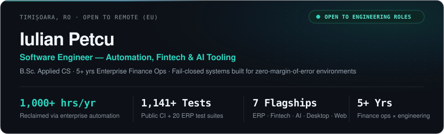
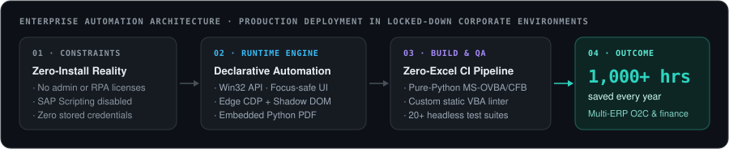
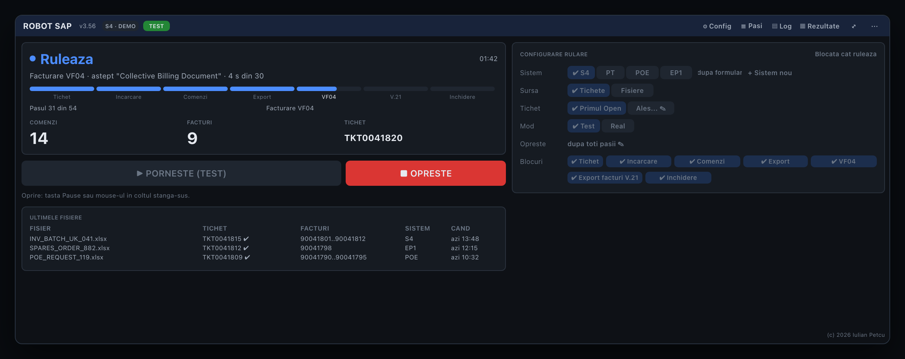
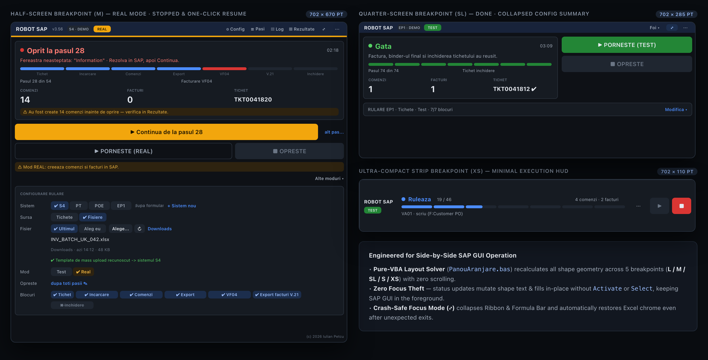
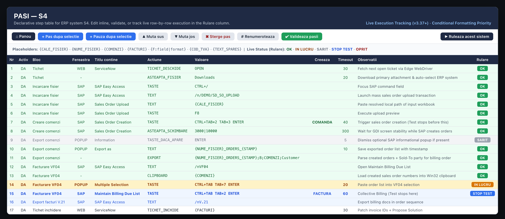
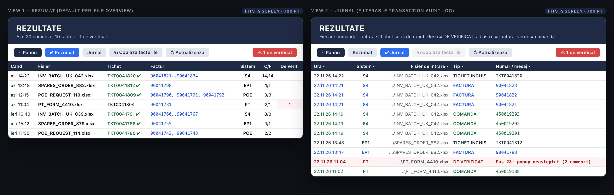
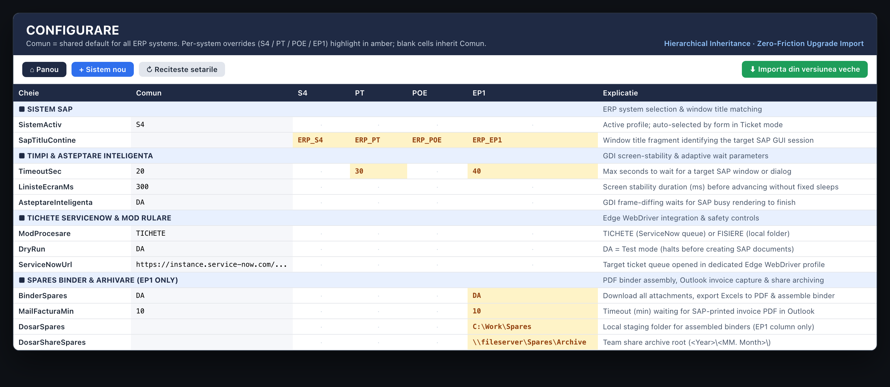
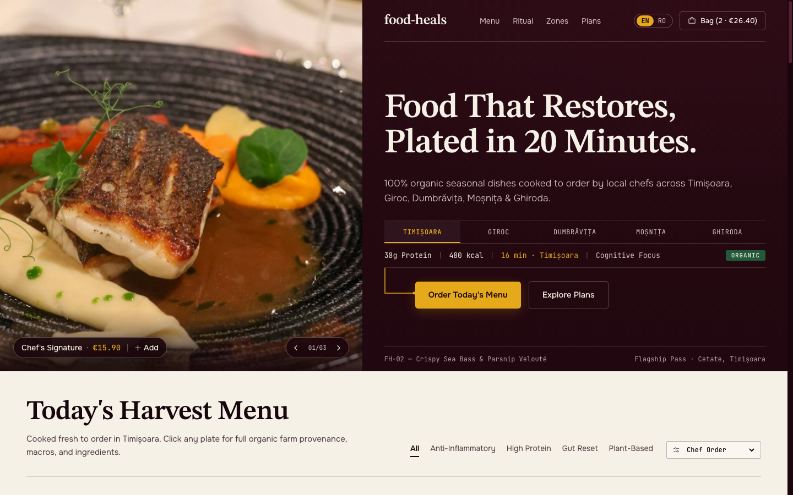

  <picture>
    <source media="(prefers-color-scheme: dark)" srcset="./assets/hero-dark.svg">
    <source media="(prefers-color-scheme: light)" srcset="./assets/hero-light.svg">
    
  </picture>

  <a href="mailto:petcuiulian@icloud.com"><strong>petcuiulian@icloud.com</strong></a>
  &nbsp;·&nbsp;
  <a href="#enterprise-automation-1000-hours-saved-annually">Enterprise Automation (Robot SAP)</a>
  &nbsp;·&nbsp;
  <a href="#fintech-desktop--ai-systems">Fintech, Desktop &amp; AI</a>
  &nbsp;·&nbsp;
  <a href="#interactive-web--frontend-engineering">Interactive Web</a>
  &nbsp;·&nbsp;
  <a href="#how-i-engineer-software">Principles</a>
  &nbsp;·&nbsp;
  <a href="#technical-stack">Tech Stack</a>

---

**Applied Computer Science graduate** with **5+ years in Fortune Global 500 finance operations**, building software where correctness, auditability, and operational controls are non-negotiable.

I started by engineering internal automation suites that **reclaimed 1,000+ hours annually** across finance teams under strict corporate IT lock-downs — and now design and ship standalone **fintech execution engines, local-first desktop systems, deterministic AI agent tooling, and high-craft interactive web applications** across **Python**, **C# / .NET 10**, **Node.js 22**, and **React / TypeScript**.

My edge is owning both sides of the problem: I know financial reconciliation, operational controls, and enterprise failure modes from the inside, and I ship tested, fail-closed software to eliminate them.

---

## Enterprise Automation: 1,000+ Hours Saved Annually

  <picture>
    <source media="(prefers-color-scheme: dark)" srcset="./assets/impact-dark.svg">
    <source media="(prefers-color-scheme: light)" srcset="./assets/impact-light.svg">
    
  </picture>

### [`Robot SAP (v3.56)`](./ROBOT-SAP-SHOWCASE.md) — Enterprise SAP GUI, ServiceNow & PDF Automation Engine

-2F6FED)
-1E9E5A)

-3776AB?logo=python&logoColor=white)

Self-contained, zero-install desktop automation engine built for locked-down corporate Windows workstations where **SAP GUI Scripting is disabled**, **third-party RPA licenses / admin privileges are unavailable**, and **credentials cannot be stored in files**:

- **Responsive 5-Breakpoint "Pupitru" Command Center (`L`, `M`, `SL`, `S`, `XS`):** Pure-VBA layout solver (`PanouAranjare.bas`) computes exact shape geometry in points with zero scrolling, **zero focus theft** (mutates shapes in-place without `Activate`/`Select` so SAP GUI stays uninterrupted), adaptive **GDI screen-stability detection**, and one-click **`▶ Continua de la pasul N`** recovery.
- **Hybrid ServiceNow Automation (Edge WebDriver/CDP + Shadow DOM):** Attaches to a dedicated corporate SSO Edge profile (zero stored passwords), executes fast ticket/attachment operations via in-session REST (`X-UserToken`), and falls back to **Shadow-DOM modal traversal** when field-level ACLs block REST state transitions.
- **Zero-Excel Cross-Platform Build Pipeline:** Keeps 100% of its ~24,900 lines of VBA across 39 modules in plain-text Git-tracked files and compiles `.xlsm` binaries and `vbaProject.bin` deterministically on macOS/Linux without Excel via a pure-Python **MS-OVBA 2.4.1 LZ77 + OLE/CFB** compiler and custom static linter (`vbalint.py`).
- **End-to-End PDF Binder & Byte-for-Byte Verification:** Captures SAP-printed invoice PDFs from Outlook COM, verifies document numbers, appends formatted product tables, and merges `.msg`/Excel/PDF attachments atomically (`os.replace`) via a self-deploying embedded Python helper (`pypdf`, `extract-msg`).
- **Functional Core (`*Logica.bas`) & 20 Headless Test Suites:** Decouples business logic from Excel/Win32 objects to test 218 layout permutations, 1,000-row mobile table shifts, keystroke-to-step recording, Node.js `jsdom` Shadow-DOM scripts, and 32-bit ARX licensing headlessly on every build.

  
   
  <strong>Robot SAP v3.56</strong> — Dark responsive command center running alongside SAP GUI (anonymized demo data). <a href="./ROBOT-SAP-SHOWCASE.md"><strong>Read the full Architectural Case Study →</strong></a>

  
<strong>View 4 More Robot SAP Screens</strong> (Responsive Breakpoints, Declarative Step Editor, Audit Journal &amp; Multi-ERP Config Matrix)

   
  <table>
    <tr>
      <td width="50%" valign="top">
        
         
        <strong>5 Adaptive Breakpoints</strong> — Half-screen REAL mode with one-click step resume, quarter-screen summary, and ultra-compact HUD strip
      </td>
      <td width="50%" valign="top">
        
         
        <strong>Declarative Steps Editor (<code>Pasi_*</code>)</strong> — Editable workflow tables with syntax validation and live row-by-row execution tracking
      </td>
    </tr>
    <tr>
      <td width="50%" valign="top">
        
         
        <strong>Two-View Results &amp; Audit Log (<code>Rezumat</code> / <code>Jurnal</code>)</strong> — Order-to-invoice sequence reconciliation &amp; 7-day verification alerts
      </td>
      <td width="50%" valign="top">
        
         
        <strong>Hierarchical Multi-ERP Configuration</strong> — Shared <code>Comun</code> defaults, amber per-system overrides (<code>S4</code>, <code>PT</code>, <code>POE</code>, <code>EP1</code>) &amp; one-click version migration
      </td>
    </tr>
  </table>

### Companion Finance Operations Automation Suite

Alongside **Robot SAP**, I engineered a suite of internal finance tools that together save **1,000+ hours annually** across the team:
- **`Contorizator Facturi v2` (`invoice-counter`):** Daily invoice and ticket journal with single/bulk entry panel, search, open-items tracking, reporting, and monthly leasing checklist — built via a deterministic Python pipeline (`openpyxl` → LibreOffice recalculation → `.xlsm` VBA packager) verified by `pytest`.
- **Offline `VF04` Invoice-to-Order Sequence Reconciler (`se16-invoice-sorter`):** Zero-network single-file browser utility (`SheetJS` + Node.js `jsdom` test suite) that maps SAP `VF04` Sold-To-grouped billing numbers back into the exact original sales-order sequence while blocking count mismatches, duplicates, or malformed document IDs.
- **ERP Mass-Upload & Intercompany Recharge Pipelines:** Automated Python and VBA validation, transformation, and batch-generation tools for high-volume ERP mass uploads and monthly cost-charge forwarding.

---

## Fintech, Desktop & AI Systems

Four standalone public systems engineered end-to-end with **1,141 automated tests**, clean architecture, CI pipelines, and fail-closed safety controls.

### [`tgmt5`](https://github.com/iulian880/tgmt5) — Risk-Controlled Telegram → MetaTrader 5 Copy-Trading Engine

Windows desktop execution engine (`PySide6 + qasync`, `Telethon`, `SQLite WAL`, official `MetaTrader5` API) engineered so **every failure mode defaults to doing nothing**:
- **Deterministic signal parser** (zero LLM hallucination risk) with strict geometry, negation, and conditional guards; ambiguous messages route to Manual Review.
- **16-rule persisted Risk Engine** (daily loss & drawdown lockouts, streak circuit breaker, correlated exposure, margin, spread, UTC sessions) + broker-driven `order_calc_profit()` sizing across 6 modes.
- **Idempotent commit-before-send execution:** every order leg commits to SQLite with a unique `TG<sig>L<leg>` tag before dispatch and reconciles positions, pending orders, and 7-day deal history before any bounded retry.
- **Double `AccountGuard`**, monitor-only startup, 3-step typed confirmation for real accounts, OS Keyring secrets with automatic log redaction, and an offline `--sandbox` simulator.

---

### [`ultimate-claude`](https://github.com/iulian880/ultimate-claude) — Deterministic Governance & Evaluation Marketplace for Claude Code

Cross-platform AI agent governance framework (**zero npm dependencies**, verified across Linux, macOS, and Windows CI) that turns best-effort prompting into auditable engineering workflows:
- **Fail-closed `PreToolUse` safety hooks** parsing chained Bash & PowerShell commands, pipes, quotes, aliases, and destructive `git` actions — plus `.xlsm` workbook backup enforcement (`uc-excel`).
- **Cryptographic v2 release gates:** computes content-based Git tree fingerprints via scratch `GIT_OBJECT_DIRECTORY` (never mutating `.git/index` or leaving objects behind) binding spec criteria, before/after code state, and OS platform.
- **Hard-verdict conformance review** (`BLOCK` on unresolved material conditions) and an **offline `stream-json` trace grader** (18 routing scenarios, SHA-256 bound reviews, paired A/B capability tests).

---

### [`finance-os`](https://github.com/iulian880/finance-os) — Local-First Finance Operations Workspace

Single-file portable Windows desktop workspace (`WPF`, `CommunityToolkit.Mvvm`, `Dapper`, `SQLite`) tailored for finance/accounting routines on locked-down machines (no install, no cloud):
- **6-project Clean Architecture** with dependency rules enforced automatically by `FinanceOS.Architecture.Tests` and a domain core decoupled from UI, storage, and Windows APIs.
- **Transactional 50-action Undo** across multi-entity batches, statement-by-statement checksummed SQL migrations, integrity checks on startup, and automated daily/pre-migration backup recovery.
- **Deterministic reminder scheduling** via `TimeProvider` / `FakeTimeProvider` (reconciling Windows scheduled toasts fired while closed), diacritic-insensitive FTS5 command palette, computed Romanian Orthodox Easter holidays, and live zero-restart **EN/RO** localization.

---

### [`noti-relay`](https://github.com/iulian880/noti-relay) — Zero-Dependency Windows Desktop Notification Relay

Portable Windows tray utility (**zero runtime NuGet dependencies**, signed sparse-MSIX / single `.exe`, no admin rights) forwarding Microsoft Teams messages, Outlook desktop toasts (`UserNotificationListener` WinRT), classic Outlook calendar updates & reminders (leak-free late-bound COM), and laptop low-battery warnings over HTTPS via `ntfy`:
- **Windows DPAPI (`CurrentUser`) encryption** with `ZeroMemory` buffer wiping for per-category ntfy topics and the atomic `.tmp`-swapped durable delivery queue.
- **Resilient delivery & operator controls:** exponential outage backoff, strict FIFO HTTP 429 pacing, launch backlog confirmation gate, instant kill-switch, privacy-first redacting logs, and a read-only 4-step network probe.

### Desktop UI Preview (Adaptive Dark / Light)

<table>
  <tr>
    <td width="50%" valign="top">
      <a href="https://github.com/iulian880/tgmt5">
        <picture>
          <source media="(prefers-color-scheme: dark)" srcset="https://raw.githubusercontent.com/iulian880/tgmt5/main/docs/screenshots/01-dashboard.png">
          <source media="(prefers-color-scheme: light)" srcset="https://raw.githubusercontent.com/iulian880/tgmt5/main/docs/screenshots/light/01-dashboard.png">
          
        </picture>
      </a>
       
      <strong>TGMT5</strong> — PySide6 trading risk console, live P&amp;L telemetry &amp; emergency controls (<code>--sandbox</code>)
    </td>
    <td width="50%" valign="top">
      <a href="https://github.com/iulian880/finance-os">
        <picture>
          <source media="(prefers-color-scheme: dark)" srcset="https://raw.githubusercontent.com/iulian880/finance-os/main/docs/screenshots/tasks-details-dark.png">
          <source media="(prefers-color-scheme: light)" srcset="https://raw.githubusercontent.com/iulian880/finance-os/main/docs/screenshots/overview-light.png">
          
        </picture>
      </a>
       
      <strong>Finance OS</strong> — .NET 10 WPF custom design system, SQLite FTS5 &amp; bilingual EN/RO UX (<code>--seed</code>)
    </td>
  </tr>
</table>

  
<strong>View NotiRelay Windows Desktop UI</strong> (<code>noti-relay</code>)

   
  

    
  

---

## Interactive Web & Frontend Engineering

Complete ground-up re-architecture of two legacy 2020 repositories into modern, zero-backend interactive web applications deployed via GitHub Actions to GitHub Pages.

### [`monster-slayer`](https://github.com/iulian880/monster-slayer) — Solar Eclipse Monolith: Tactical Reflex Browser Battler

Play-First tactical reflex monster-slaying game and interactive studio monograph (**[Play Live ↗](https://iulian880.github.io/monster-slayer/)**):
- **Deterministic 4-Action Combat + Live Solar Corona Timing Arc:** Distills combat to `Strike [1]`, `Rupture [2]`, `Mend [3]`, and `Pact [4]` against telegraphed Sovereign intent, paired with a 60fps HTML5 Canvas timing needle that rewards precision with **`1.75×` Perfect Strikes**, **Counter-Parries**, and **Posture Shatters**.
- **Eclipse Altar, *Double or Dust* Wager & Deterministic Daily Seed:** Between acts, claim build-defining Relics or risk accumulated bounty on an Overdrive escalation; every UTC day generates a deterministic Daily Run via a `Mulberry32` PRNG alongside an interactive Canvas Bestiary Monograph and procedural Web Audio synthesis.

---

### [`food-heals`](https://github.com/iulian880/food-heals) — Bilingual (EN/RO) Organic Culinary & Daily Nutrition Platform

Editorial bilingual (**English / Romanian**) storefront and interactive ordering platform for organic chef-crafted meals across the Timișoara metropolitan area (**[View Live ↗](https://iulian880.github.io/food-heals/)**):
- **Co-Equal Bilingual Parity (`EN` / `RO`) & *Saffron & Fig Lacquer* Design System:** Instant zero-reload language and currency (`EUR` / `lei`) switching with full Romanian diacritics, self-hosted variable typography (`STIX Two Text`, `Onest`, `JetBrains Mono`), and WCAG AA accessible contrast.
- **Interactive Harvest Menu, 5-Zone Sync & Kitchen Bag:** Dietary goal filtering (`Anti-Inflammatory`, `High Protein`, `Gut Reset`, `Plant-Based`), tabular macro ledgers, Culinary Specimen Modal with Banat farm provenance, synchronized 5-zone dispatch board (*Timișoara, Giroc, Dumbrăvița, Moșnița, Ghiroda*), and persistent slide-over order bag.

<table>
  <tr>
    <td width="50%" valign="top">
      
       
      <strong>Monster Slayer</strong> — HTML5 Canvas solar-corona timing arena, telegraphed intent &amp; procedural Web Audio (<a href="https://iulian880.github.io/monster-slayer/">Live Demo ↗</a>)
    </td>
    <td width="50%" valign="top">
      
       
      <strong>food-heals</strong> — Bilingual (EN/RO) editorial storefront, 5-zone Timișoara sync &amp; interactive macro ledger (<a href="https://iulian880.github.io/food-heals/">Live Demo ↗</a>)
    </td>
  </tr>
</table>

---

## How I Engineer Software

- **Fail-closed by default:** Ambiguous trading signals escalate to manual review instead of guessing (`tgmt5`); destructive shell chains and unbacked `.xlsm` writes hard-block at the tool boundary (`ultimate-claude`); unexpected SAP dialogs halt and offer one-click step resume (`Robot SAP`); missed notifications wait for explicit confirmation (`noti-relay`).
- **Idempotency & crash recovery first:** Every order commits to SQLite WAL before broker dispatch (`tgmt5`); PDF binders merge atomically via `os.replace` and verify attachments byte-for-byte (`Robot SAP`); persistent queues swap via `.tmp` files (`noti-relay`); SQL migrations enforce checksums inside per-migration transactions (`finance-os`).
- **Deterministic core, thin imperative shell:** Business logic, risk rules, parsers, layout solvers, and scheduling math stay decoupled from UI, OS APIs, and network I/O so they run in fast headless suites (**1,141 public tests + 20+ headless enterprise suites**).
- **Engineered for real-world constraints:** Zero-install `.xlsm` engines and single portable executables, minimal or zero runtime dependencies, per-user storage without administrator rights, OS Keyring / DPAPI secret hygiene, and automatic secret redaction in logs.

---

## Technical Stack

| Domain | Technologies & Craft |
|---|---|
| **Languages** | Python (3.12+), C# (.NET 10), TypeScript (5.8), JavaScript / Node.js 22 (ESM), SQL, VBA |
| **Desktop & Systems** | PySide6 / Qt (`qasync`), WPF (MVVM, custom design systems), Win32 API (`user32`, `gdi32`), WinRT, Late-Bound COM, DPAPI |
| **Web & Interactive UI** | React 19, Vite 6, Tailwind CSS v4, HTML5 Canvas, Web Audio API, GSAP + ScrollTrigger, WCAG AA accessibility |
| **Data & Persistence** | SQLite (WAL, FTS5, `STRICT`, transactional migrations), Dapper, SQLAlchemy, Alembic |
| **AI & Enterprise Automation** | Claude Code plugins & fail-closed hooks, offline trace evals, SAP GUI / ServiceNow (Edge CDP + Shadow DOM) / PDF pipelines, pure-Python MS-OVBA/CFB compiler |
| **Testing & Delivery** | `pytest`, `xUnit v3`, `node:test`, Architecture Tests, `jsdom`, LibreOffice headless Basic + custom `vbalint`, GitHub Actions CI |
| **Domain Depth** | Finance & accounting operations, Order-to-Cash (O2C), reconciliation & controls, trading risk management, bilingual EN/RO UX |

---

## Background & Contact

- **Education:** B.Sc. in Applied Computer Science — West University of Timișoara (2017–2020)
- **Languages:** Romanian (Native) · English (C1 — Cambridge CAE) · German (B1)
- **Currently Exploring:** RAG pipelines over financial documents, deterministic LLM agent workflows, FastAPI & containerized backend services
- **Availability:** Open to **Remote (EU)** and **Timișoara (Hybrid)** engineering roles — Software Engineering, Automation, Fintech & AI Tooling

📫 **Reach me directly:** [petcuiulian@icloud.com](mailto:petcuiulian@icloud.com)
