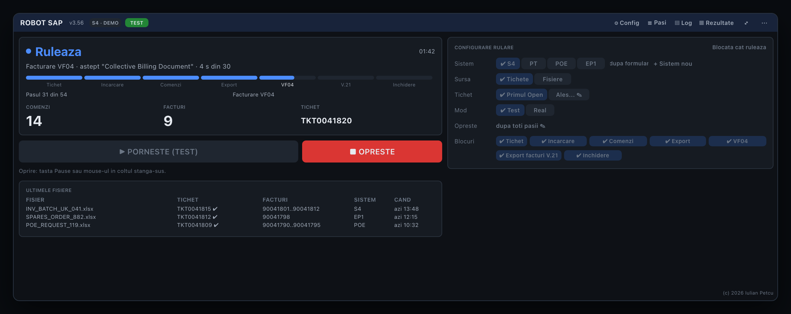
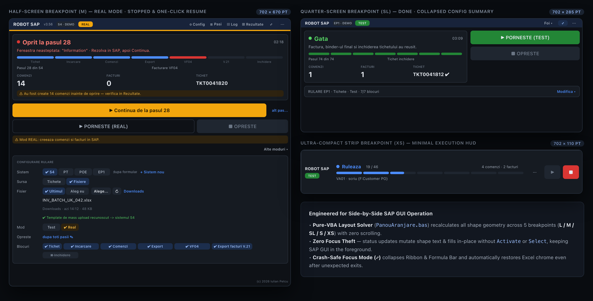
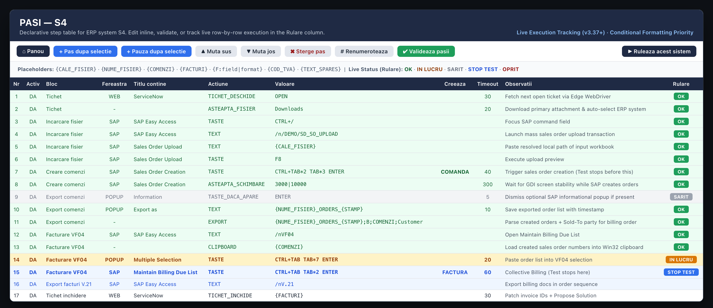
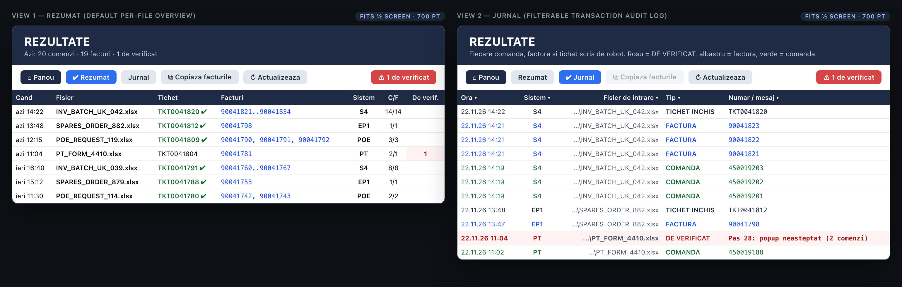
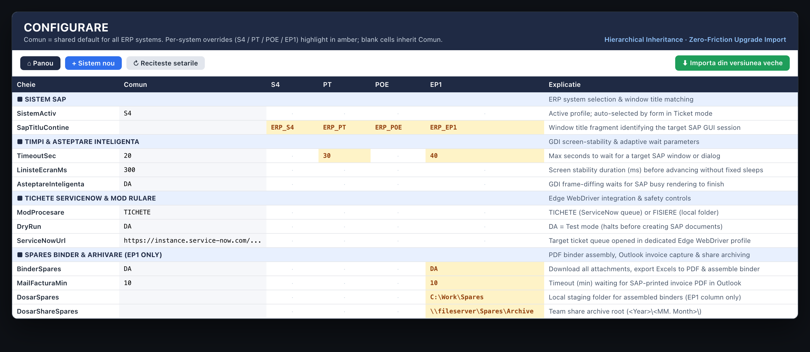
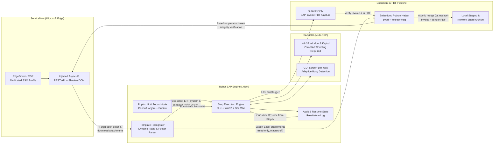

  <a href="./README.md"><strong>← Back to Iulian Petcu's GitHub Profile</strong></a>

# Robot SAP (v3.56) — Architectural Case Study

**Enterprise SAP GUI, ServiceNow & Document Automation Engine — Built Inside Excel VBA Without External RPA Infrastructure**

-2F6FED)
-1E9E5A)

-3776AB)

-D64545)

 

*The **Pupitru** dark responsive command center (`v3.42+`) running live alongside SAP GUI — zero-scroll adaptive layout, segmented block progress bar, live order/invoice counters, and focus-safe execution.*

---

> **Showcase Notice**
> This public case study documents the architecture, user interface, and engineering decisions behind **Robot SAP** (`v3.56`) — the flagship internal system behind **1,000+ hours saved annually** across finance operations. All screenshots and examples use anonymized demonstration data. Compiled deliverables and proprietary workflow mappings remain in a private repository under **All Rights Reserved**.

---

## Overview

**Robot SAP** is a self-contained, zero-install desktop automation suite engineered to automate end-to-end **Order-to-Cash (O2C)** and **ServiceNow ticket processing** across multiple SAP ERP systems directly from Microsoft Excel (`Windows / Excel 365`), while being developed, built, and automatically tested cross-platform on macOS without Microsoft Excel.

### The Problem It Solves

In enterprise finance and order-management teams, operators spend hours every day repeating identical cross-application loops:
1. Pull the next open ticket from **ServiceNow** and download Excel request forms & supporting attachments.
2. Parse structured forms (with variable-length item tables, tax codes, PO numbers, and formatting rules) or mass-upload templates.
3. Enter orders and trigger billing across multiple **SAP GUI** systems (`VA01`, `VF01`, `VF02`, `VF04`, `V.21`, `F-22`, `FB03`, `F.61`, and custom upload transactions).
4. Capture printed invoice PDFs from **Microsoft Outlook**, assemble ordered multi-document **PDF Binders**, attach them back to the ticket, archive to shared drives, and resolve the ticket.

In locked-down corporate environments, traditional automation hits three hard walls:
- **SAP GUI Scripting is disabled** at the server level by IT security policies.
- **Third-party RPA platforms** (UiPath, Power Automate Desktop) require licensing, VM infrastructure, or admin privileges.
- **Credentials cannot be stored** in scripts or external config files.

**Robot SAP** bypasses all three constraints: it runs inside an ordinary `.xlsm` workbook using Win32 APIs, reuses the operator's authenticated Edge SSO session via WebDriver/CDP, and ships a deterministic, self-deploying Python PDF helper embedded directly inside the workbook.

---

## Visual Tour

### 1. Responsive "Pupitru" Command Center (5 Adaptive Breakpoints)

Operators keep **SAP GUI on one half of the screen** and Excel on the other half or in a quarter-screen corner. Instead of a fixed scrolling spreadsheet, `PanouAranjare.bas` computes exact shape geometry in points across **5 breakpoints (`L`, `M`, `SL`, `S`, `XS`)** with zero scrolling, a single primary action per state, and an amber visual safety theme for **REAL** mode.

- **Half-Screen (`M`) — REAL Mode & One-Click Resume**: After an unexpected SAP dialog stops the run, the panel highlights the failed block in red, displays a safety warning if documents were already created, and promotes **`▶ Continua de la pasul N`** as the primary CTA so the operator can fix the SAP screen and resume cleanly without recreating orders.
- **Quarter-Screen (`SL`) — Done**: Collapses configuration into a single summary strip (`Modifica ▾`) while keeping status, block progress, and Start/Stop controls visible at arm's length.
- **Ultra-Compact Strip (`XS`)**: Turns Excel into a single-ribbon execution HUD while Focus Mode (`⤢`) hides the Ribbon and Formula Bar.

---

### 2. Declarative Steps Editor with Live Execution Tracking

Every ERP workflow is defined as an editable table (`Pasi_*`) rather than hardcoded VBA macros. Operators can toggle individual steps, skip blocks, validate syntax before running, and watch live row-by-row execution in the **`Rulare`** column (`OK`, `IN LUCRU`, `SARIT`, `STOP TEST`, `OPRIT`).

---

### 3. Two-View Results Sheet (`Rezumat` & `Jurnal`)

Designed to fit comfortably inside **½ screen (700 pt)** with zero horizontal scrolling, the `Rezultate` sheet switches between two views over the same underlying audit table:
- **Rezumat** (default): Per-file overview of the latest 25 runs — closed ticket badges (`✔`), invoice lists mapped back to original order sequence, Orders/Invoices ratio (`C/F`), one-click clipboard copy (`⧉`), and a 7-day **`⚠ de verificat`** alert badge.
- **Jurnal**: Filterable transaction-level audit log with color-coded `COMANDA`, `FACTURA`, `TICHET INCHIS`, and `DE VERIFICAT` rows.

---

### 4. Multi-System Configuration Matrix with Inheritance

One workbook drives **4 distinct ERP workflows** (`S4`, `PT`, `POE`, `EP1`) plus unlimited user-recorded systems. The `Config` sheet uses hierarchical inheritance: `Comun` holds shared defaults, while per-system overrides highlight in amber — and **`⬇ Importa din versiunea veche`** migrates settings, custom templates, and history automatically when upgrading versions.

---

## System Architecture

---

## Technology Stack & Architectural Rationale

Every technology choice in Robot SAP was driven by real enterprise deployment constraints (locked-down Windows laptops, zero IT install permissions, disabled SAP Scripting) combined with modern software engineering discipline (Git-first plain-text sources, deterministic builds, and automated headless CI tests).

| Layer | Technology | Why It Was Chosen |
|---|---|---|
| **Runtime & UI** | **Excel VBA (Excel 365, 32/64-bit)** | Zero deployment friction on corporate Windows workstations — every analyst already has Excel; distributes as a single self-contained `.xlsm` file. |
| **SAP GUI Automation** | **Win32 API (`user32`, `kernel32`, `gdi32`)** | Works reliably even when **SAP GUI Scripting is disabled** by IT/Basis security policies. Direct `keybd_event`, window class/title verification, and GDI screen-stability detection eliminate brittle hardcoded delays. |
| **ServiceNow Integration** | **Edge WebDriver (`msedgedriver`) + CDP + Async JS** | Reuses the operator's authenticated corporate SSO session in a dedicated Edge profile with **zero stored passwords**. Combines ServiceNow REST API (`X-UserToken`) with Shadow-DOM UI automation where ACLs block API state transitions. |
| **Document & PDF Assembly** | **Embedded Python 3 (`pypdf`, `extract-msg`) + Outlook COM** | Handles `.msg` email approval extraction, Excel-to-PDF conversion, full product-table appending, and atomic PDF merging (`os.replace`). Shipped inside the `.xlsm` as a generated ASCII VBA module that self-deploys at runtime. |
| **Cross-Platform Build System** | **Python 3 (`openpyxl`, `olefile`, `oletools`, custom MS-OVBA & OLE/CFB)** | Compiles `.xlsm` workbooks and `vbaProject.bin` straight from plain-text Git-tracked `.bas`/`.cls` modules on **macOS/Linux without Microsoft Excel** — enabling clean diffs, version control, and reproducible releases. |
| **VBA Testing & Static Analysis** | **LibreOffice Headless Basic + Custom Python Linter (`vbalint.py`)** | Executes real pure-VBA logic modules headlessly in an isolated LibreOffice profile (`20` automated test suites), while static analysis catches Excel-specific syntax/scoping traps that LibreOffice ignores. |
| **Web Script Verification** | **Node.js + `jsdom` (with simulated clocks & Shadow DOM)** | Tests all VBA-generated ServiceNow JavaScript scripts against a simulated Shadow-DOM page (modals, trap buttons, wrong-ticket guards, HTTP errors) in milliseconds. |

---

## Deep Dive: Key Engineering Decisions

### 1. Functional Core, Imperative Shell in VBA
VBA projects often turn into untestable monoliths because business logic is tangled with `Worksheet`, `Shape`, and Win32 calls. Robot SAP strictly separates every complex subsystem into two layers:
- **Pure Logic Modules (`*Logica.bas`)**: `PanouAranjare.bas`, `SablonLogica.bas`, `InterpretorLogica.bas`, `BrowserLogica.bas`, `RezultateLogica.bas`, `BinderLogica.bas`, `Ep1Logica.bas`, and `LicentaLogica.bas` — zero `Excel` or `Win32` object references.
- **Thin Platform Adapters**: `Pupitru.bas`, `Sabloane.bas`, `Inregistrare.bas`, `Browser.bas`/`Tichete.bas`, `Foi.bas`, `Binder.bas`, `Ep1.bas`, and `Licenta.bas`.

**Why this matters**: All core algorithms — responsive layout math across 218 window/state permutations, template label-shift matching up to row 1,000, keystroke-to-step interpretation, JSON/Base64 encoding, billing-order reconciliation, tax/PO extraction, and hardware license verification — run as **real VBA code** inside automated tests on every build.

### 2. Zero-Excel Cross-Platform Build Pipeline
Microsoft Excel stores VBA code inside a compressed OLE Compound File Binary (`xl/vbaProject.bin`). Instead of manually editing code inside the Excel VBE, Robot SAP keeps 100% of its source in plain text (`vba/*.bas`, `vba/*.cls`, `tools/pasi_livrate/*.tsv`, `tools/sabloane_livrate/*.tsv`) and builds the `.xlsm` deterministically from scratch:
1. **`vbalint.py`** runs static checks (e.g., catching `&Name` parsed as a `Long` suffix, constants declared after procedures, local variables shadowing module names, missing `Option Explicit`).
2. **Code generators** (`pasi_s4hana.py`, `gen_binder_script.py`) assemble declarative step defaults and embed the Python PDF binder script as a verified ASCII VBA module (`BinderScript.bas`).
3. **`ovba.py` + `cfb.py` + `build_bin.py`** implement **MS-OVBA 2.4.1 LZ77 compression** and **OLE/CFB binary stream serialization** in pure Python to produce a fresh `vbaProject.bin` with cleared p-code cache (Excel cleanly recompiles on open).
4. **`build_v3.py`** uses `openpyxl` to construct all sheets, formatting, conditional rules, and button layouts, reading palette constants and column widths directly from the VBA sources as a single source of truth.

### 3. Hybrid ServiceNow Automation (Edge WebDriver + Shadow DOM)
ServiceNow instances frequently enforce field-level ACLs where a REST `PATCH` updates invoice numbers and comments cleanly, yet silently ignores `state = 6 (Resolved)` without returning an HTTP error.
- Robot SAP starts a dedicated **Microsoft Edge** instance (`--remote-debugging-port`) attached via `msedgedriver.exe` (`debuggerAddress`) so the user signs in once with enterprise SSO.
- Fast data operations (finding the next open ticket, detecting **Credit Note** vs. **Invoice** target fields from Service Offering metadata, downloading attachments, uploading verified PDFs) execute via in-session `fetch()` with `window.g_ck` (`X-UserToken`).
- State resolution automatically falls back to **Shadow-DOM traversal** on the open ticket page — verifying the displayed ticket number matches before clicking **Propose Solution → Submit** inside the modal dialog and polling until `State = Resolved`.
- All parameters entering injected JavaScript are strictly whitelisted (`[A-Za-z0-9]`, 32-char hex `sys_id`, `[a-z0-9_]` field names) to prevent injection.

### 4. Smart Waiting & Zero Focus Theft
- **Adaptive GDI Wait (`ASTEAPTA_SCHIMBARE`)**: Rather than waiting fixed 10–30 second timers while SAP processes batches, the engine captures window bitmaps via GDI and monitors pixel stability + cursor state, advancing as soon as SAP finishes rendering (with configurable fallback timeouts).
- **Zero Focus Theft**: During execution, the Pupitru panel never calls `Activate`, `Select`, or modal dialogs — mutating shape text and progress bar widths in-place so SAP GUI remains uninterrupted in the foreground. A static test (`test_panou_static.py`) enforces this invariant on every build.
- **Emergency Kill-Switch**: Pressing the `Pause` key or moving the mouse cursor to `(0, 0)` (top-left screen corner) immediately halts keystroke emission between steps.

### 5. Intelligent Form Recognition & Action Recorder
- **Dynamic Form Parsing**: Learns structured Excel input forms by fixed label geometry and supports **mobile-table shifting** (`MOBIL`) so forms with variable product tables (up to 1,000 rows) automatically locate shifted footers, totals, PO numbers, and VAT rates.
- **Order-to-Invoice Sequence Mapping**: SAP `VF04` bills orders grouped by `Sold-To Party`, which can scramble the original order sequence. Robot SAP parses the `Customer` column during order export and reconstructs invoice numbers in the exact original order sequence for ticket closure and reporting.
- **Action Recorder & Step Interpreter**: Built-in *"Learn New System"* and *"Learn Difference"* modes record live Win32 keyboard/window events, filter out SAP type-ahead popups and stray clicks, match typed values against input templates, and generate parameterized `{F:field|format}` step tables automatically.

### 6. End-to-End Document & PDF Integrity (Spares Workflow)
For complex multi-document spares tickets (`EP1`), the robot executes the full lifecycle:
- Detects **Credit Limit** holds in `F-22` before saving, exits cleanly without posting, moves the ticket to **Awaiting Info**, and logs the hold.
- Captures the SAP-printed invoice PDF from **Outlook COM**, verifies it contains the exact posted document number (ignoring colleagues' emails), appends the complete formatted line-item breakdown table from Excel, and atomically replaces the file (`os.replace`) — preserving prior copies if any step fails.
- Merges all supporting ticket attachments (Excel exports opened read-only with `AutomationSecurity = 3` + `.msg` email approvals + PDFs) into a final stamped binder.
- **Pre-Closure Verification**: Before resolving the ticket, confirms both local PDFs exist with non-zero size, compares any existing ticket attachments **byte-for-byte** on resume (reusing identical files, halting for manual reconciliation on any content mismatch), and archives the folder to the team share under `<Year>/<MM. Month>/`.

### 7. Machine-Bound Licensing Core
`LicentaLogica.bas` implements a portable 32-bit **ARX keyed PRF** (no byte arrays, no `LongLong`) that derives deterministic `XXXX-XXXX-XXXX-XXXX` Base32 machine codes and activation keys identically across 32-bit Excel, 64-bit Excel, and LibreOffice Basic. Separate build scripts produce licensed and unlicensed editions from the same source tree.

---

## Quality & Automated Verification

A single command (`tools/verifica.sh`) executes the complete verification pipeline on every change:

1. **Automated Backup** — snapshots previous output before writing (retains rolling history).
2. **Static VBA Linting** — enforces strict VBA/Excel rules before building.
3. **Zero-Excel Build** — regenerates embedded scripts, compiles `vbaProject.bin`, and assembles the `.xlsm`.
4. **Headless Compilation Check** — compiles target modules inside LibreOffice Basic (`unocheck.py`).
5. **20 Automated Test Suites**:
   - **Responsive UI Geometry (`test_panou_aranjare.py`)**: Verifies 218 window-size & state combinations (breakpoint selection, zero clipped elements, zero overlapping shapes, minimum 24 pt hit targets).
   - **Static Invariants (`test_panou_static.py`, `test_rezultate_static.py`)**: Enforces zero `Activate`/`Select` in the execution path, no local variables shadowing module names, crash-safe Focus Mode restoration, and 700 pt half-screen column budgets.
   - **ServiceNow JS & Shadow DOM (`test_scripturi_js.py` + `tools/js/test_scripturi.js`)**: Runs VBA-generated JS scripts in Node.js + `jsdom` against simulated ServiceNow Shadow DOM, modals, wrong-ticket guards, trap buttons, and fake timers.
   - **Form Parsing & Step Interpretation (`test_sablon.py`, `test_sablon_decalaj.py`, `test_formular.py`, `test_istoric.py`, `test_interpretor.py`, `test_diferenta.py`, `test_pasi_livrati.py`, `test_pas_cu_pas.py`)**: Tests label/field detection, 159-row shifted tables, keystroke recording interpretation, and step validation across all shipped workflows.
   - **EP1 & PDF Binder Regressions (`test_ep1_logica.py`, `test_binder_logica.py`, `test_binder_spares.py`)**: Tests VAT code logic, correspondence formatting, invalid/empty PDF guards, atomic replacement, and byte-identical embedded script integrity.
   - **Results, Licensing & Process Hygiene (`test_rezultate.py`, `test_licenta.py`, `test_ruleaza.py`, `test_backup_build.py`)**: Tests 200-key licensing round-trips, resume state recovery, and clean LibreOffice process-group teardown on timeout.

---

## Project Metrics

| Metric | Value |
|---|---|
| **Release Maturity** | `v3.56` (56 iterative production releases) |
| **VBA Application Code** | ~24,900 lines across 39 modules (`.bas` / `.cls`) |
| **Python & JS Tooling / Tests** | ~6,700 lines across build pipeline, linter & 20 test suites |
| **Supported ERP Profiles** | 4 production workflows shipped + unlimited recorded workflows |
| **Responsive UI Breakpoints** | 5 adaptive tiers (`L`, `M`, `SL`, `S`, `XS`) · 218 tested layout states |
| **External Runtime Dependencies** | Microsoft Excel 365, SAP GUI, Edge WebDriver (`msedgedriver`), optional Python 3 for PDF binders |

---

  <a href="./README.md"><strong>← Back to Iulian Petcu's GitHub Profile</strong></a>

